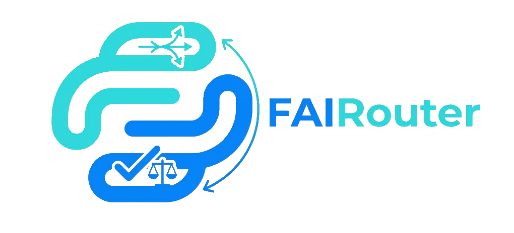

# FAIRouter for .NET

**Picks the right executor for each task and checks what it delivered.**

FAIRouter is a library for routing requests between LLM models, agents and tools. It includes a judge that measures the result and training on feedback.

You have a dozen models and agents. Prices differ by orders of magnitude, speed by several times, and each model has its own strengths: one is good at code, another at writing. Sending everything to the strongest model is expensive, sending everything to the cheapest one loses quality, and choosing by hand for every task does not scale. FAIRouter makes that choice for you, then checks the result and learns from it.

- **Quality that is enough for the job.** The router first filters out executors that are predicted to fall short of the required bar.
- **No paying for extra power.** Among those that reach the bar, price and expected time decide, so a cheap model wins where it can cope.
- **Know what you got.** The judge compares the finished answer with what was requested and reports the differences item by item. For example: 4 sections and a table requested, 1 section and no tables delivered.
- **Gets more accurate over time.** Feedback accumulates, weights are trained, and candidates specialize by task type.

## Installation

```bash
dotnet add package FAI.Router
```

Requires .NET 10.

## Quick start

```csharp
using FAI.Router;

FaiRouter router = await FaiRouter.FromOpenRouterAsync(
    apiKey: Environment.GetEnvironmentVariable("OPENROUTER_API_KEY")!,
    modelIds: ["google/gemini-2.5-flash", "openai/gpt-4.1-mini", "anthropic/claude-haiku-4.5"],
    databasePath: "fai-router.db");                 // weights and history, created if missing

RouterAnswer answer = await router.AskAsync("Write a 1500-character overview of clustering methods");

Console.WriteLine($"{answer.Winner.Name}: {answer.Score}");
Console.WriteLine(answer.Text);
Console.WriteLine(answer.Critic);                   // differences from the request, item by item

router.Feedback(answer.RoundId!.Value, score: 1.0); // from 0 (bad) to 1 (excellent)
router.Train(epochs: 10);
router.Save();
```

If you do not list any models, the choice is made among popular models bundled with the package.

## Providers

| Factory | Provider |
|---|---|
| `FaiRouter.FromOpenRouterAsync` | [OpenRouter](https://openrouter.ai) |
| `FaiRouter.FromFractalRouterAsync` | [FractalRouter](https://fractalrouter.ru) |
| `FaiRouter.FromOpenAiCompatibleAsync` | Any server with the OpenAI chat completions protocol |

Your own candidates, executor and judge client are passed to the `FaiRouter` constructor, so the router can choose between agents and tools as well as models.

## Links

- [Source code](https://github.com/MASFractal/FAIRouter)
- [Documentation and measurements](https://github.com/MASFractal/FAIRouter#readme) (in Russian)
- [.NET implementation notes](https://github.com/MASFractal/FAIRouter/blob/main/CSharp/README.md) (in Russian)
- [Report an issue](https://github.com/MASFractal/FAIRouter/issues)

Licensed under [Apache-2.0](https://github.com/MASFractal/FAIRouter/blob/main/LICENSE).
