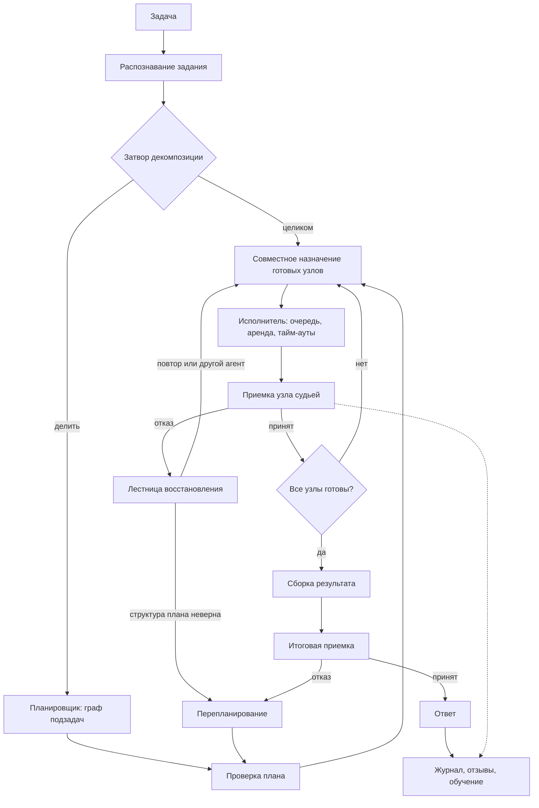

# Маршрутизация задач между агентами

Черновик архитектуры для обсуждения, 03.11.2026. Документ описывает, как расширить FAIRouter от
выбора модели под запрос до выбора агента под задачу, в том числе раздачи частей одной задачи
нескольким агентам параллельно.

## В сухом остатке

* Задача сначала распознается и проходит **затвор декомпозиции**: делить ли ее вообще. Деление
  стоит дорого (у Anthropic многоагентный прогон съедает в разы больше токенов, чем один агент),
  поэтому по умолчанию задача идет одному агенту целиком.
* Составная задача превращается в **граф подзадач**: узлы с собственным заданием, ребра по данным.
  Независимые узлы исполняются одновременно.
* Для каждого узла исполнитель выбирается тем же механизмом, что и модель сейчас: отсев по
  возможностям и политике, метрика `R`, планка достаточности, температура для разведки. Новое в
  метрике: время ожидания в очереди агента и вес времени, зависящий от положения узла на
  критическом пути.
* Готовые к запуску узлы назначаются **совместно**, с учетом свободных мест у агентов, общего
  бюджета и конфликтов по ресурсам, а не каждый сам по себе.
* Раздача бывает трех видов: **разбиение** (разные части разным агентам), **дублирование** (одна
  часть нескольким, лучший ответ берет судья) и **страховочный запуск** (второй агент стартует, если
  первый опаздывает).
* Каждый узел принимает судья по его заданию, итог принимает судья по исходному заданию. Отказ
  приемки запускает лестницу восстановления: повтор с замечаниями, следующий кандидат, более сильный
  уровень, перепланирование, человек.
* Обучение идет по узлам и по корню: вектор агента учится на приемке его узлов, планировщик и
  затвор учатся на расхождении «все узлы приняты, а итог плохой».
* Готового продукта, который учит маршрутизацию агентов по исходам, обзор не нашел. Исполнение
  графов и параллельность хорошо закрыты Microsoft Agent Framework и LangGraph, обмен с внешними
  агентами закрыт A2A и MCP. Ниша FAIRouter в слое решения: кого назначить, хватит ли качества,
  что сделано на самом деле, и как стать точнее.

## Постановка

Нужно покрыть четыре случая.

1. **Одна задача, один агент.** «Проверь этот договор» уходит юристу, а не копирайтеру.
2. **Составная задача, независимые части.** «Проанализируй рынок, посчитай цену и напиши
   коммерческое предложение» делится на части, часть из них идет одновременно разным агентам.
3. **Одна задача, несколько агентов ради надежности.** Когда ошибка дорога, а прогноз неуверен,
   одну и ту же часть исполняют два-три разных агента, судья берет лучший ответ.
4. **Вложенное делегирование.** Агент сам решает, что ему нужен помощник, и обращается к тому же
   маршрутизатору. Здесь важны предел глубины, бюджет и права.

Ограничения: обе версии библиотеки (Python и C#), работа без внешней инфраструктуры для простого
случая, возможность подключить надежную среду исполнения для промышленного.

## Как это делают другие

| Подход | Кто | Как выбирается исполнитель | Параллельность | Учится по исходам |
|---|---|---|---|---|
| Явный граф | LangGraph | узел-маршрутизатор пишет разработчик, обычно правило или вызов модели | узел возвращает список `Send`, каждая ветка со своим состоянием, сборка через редуктор | нет |
| Пять шаблонов | Microsoft Agent Framework 1.0 (Python и .NET) | последовательно, одновременно, групповой чат с ведущим, передача по правилам, «магентик» с ведущим, который ведет план и журнал хода | шаблон Concurrent: раздача и сбор | нет |
| Передача управления | OpenAI Agents SDK | модель сама передает разговор другому агенту или зовет его как инструмент | ограниченная | нет |
| Ведущий и исполнители | исследовательская система Anthropic | ведущий агент делит задачу и запускает 3–5 подагентов одновременно | да, это основа шаблона | нет |
| Карточки агентов | протокол A2A | клиент читает карточку агента (навыки, адрес, доступ) и открывает задачу | не задается протоколом | нет |
| Шлюзы | Envoy Agent Router, TrueFoundry | по правилам и заголовкам, на уровне трафика | на уровне сети | нет |
| Обучаемая маршрутизация МАС | MasRouter (ACL 2025) | выбирает способ сотрудничества, роли и модель для каждой роли, учится с подкреплением | да | да, но на бенчмарках |
| Граф вызовов | LLMCompiler | планировщик выдает граф вызовов, независимые вызовы идут одновременно | да | нет |

Эти данные показывают разрыв. Исполнять граф умеют все крупные системы, а решение «кому» в них
либо пишет разработчик, либо принимает модель без памяти о прошлых исходах. Обзор Zylos (сентябрь
2026) делает тот же вывод: в промышленных системах преобладает реестр с проверкой здоровья и
запасным вариантом, а обучаемые сигналы пока остаются экспериментом. Оттуда же стоит взять правило:
описание агента это заявление, а маршрутизировать нужно по проверенным свидетельствам.

## Что уже есть в FAIRouter и как оно переносится

| Сейчас (модели) | Станет (агенты) |
|---|---|
| `RoutedElement`: цены, скорость, возможности, обучаемый вектор | `AgentProfile`: те же поля плюс навыки, права, места для одновременной работы, живое состояние |
| `Specifications`: заказ и факт одним типом | задание узла и факт узла тем же типом, плюс входы, артефакты на выходе, ресурсы, риск |
| `InputFeatures`, вектор признаков | без изменений, агент сравнивается с задачей в том же пространстве |
| метрика `R = WQ·q − WC·c − Wt·t` | та же метрика, `t` включает ожидание в очереди, `Wt` зависит от критического пути |
| планка достаточности и калибровка | без изменений, применяется к каждому узлу, ее вероятность нужна и для решения о дублировании |
| температура и разведка | без изменений, плюс бюджет разведки только для задач с низким риском |
| запасной вариант при отказе (`env.execute`) | лестница восстановления узла |
| судья и критик (`DiffSpec`) | приемка узла и итоговая приемка |
| журнал ходов, отзывы, обучение | журнал прогонов с деревом узлов, распределение заслуг |
| сервер с моделью `auto` | тот же сервер, агент `auto` |

Как отмечалось выше, ядро выбора не меняется. Меняется то, что вокруг него: появляются планировщик,
совместное назначение и исполнитель графа.

## Общая схема



## Компоненты

### 1. Профиль агента

Профиль делится на четыре слоя с разными правами на запись. Деление взято из обзора Zylos и
закрывает главный риск: агент не может сам объявить себя лучшим.

| Слой | Что внутри | Кто пишет |
|---|---|---|
| Заявленное | имя, версия, навыки (`TaskKind`, `Domain`), модальности, адрес, требуемые входы, артефакты на выходе | владелец агента, карточка A2A |
| Проверенное | разрешенные инструменты и серверы MCP, классы данных, регион, наибольшие права, класс риска действий | администратор |
| Свидетельства | обучаемый вектор, опыт, дисперсия отзывов, фактическая цена и время по типам задач, история отказов | только маршрутизатор |
| Живое | здоровье, свободные места, длина очереди, лимиты, время последнего отклика | среда исполнения |

```python
@dataclass
class AgentProfile:
    name: str
    version: str
    # Заявленное: с этого начинается холодный старт, но в выбор оно идет только как приор
    skills: list[TaskKind]
    domains: list[Domain]
    capabilities: Capability
    produces: list[str]           # виды артефактов: "text", "table", "code", "file"
    endpoint: AgentEndpoint       # локальная функция, A2A, OpenAI-совместимый, человек
    # Проверенное
    tools: list[str]
    risk_class: RiskClass         # READ_ONLY, WRITES_INTERNAL, EXTERNAL_EFFECT
    max_concurrency: int
    # Свидетельства: тот же RoutedElement, что у моделей
    element: RoutedElement
    cost_model: CostModel         # для агента цена считается по фактическим прогонам
```

Цена агента считается иначе, чем цена модели. Модель стоит по прайсу за токены, а агент делает
неизвестное заранее число вызовов. Поэтому нужен интерфейс `CostModel`: прайс за токены для модели,
цена вызова для инструмента, среднее по фактическим прогонам данного типа задач для агента. Обзор
Zylos советует то же: стоимость берется из факта, а не из заявленного.

Свой агент, у которого задачи и инструменты фиксированы, а модель меняется, разумно заводить как
несколько кандидатов «агент × модель». Так делает MasRouter: роль и модель для роли выбираются
вместе. Внешний агент выбирает модель сам, и для маршрутизатора он один кандидат.

### 2. Задание узла

Задание узла расширяет `Specifications`, а не заменяет его: судья по-прежнему сравнивает заказ и
факт одним типом.

```python
@dataclass
class TaskNode:
    id: str
    spec: Specifications          # что заказано: тип, область, объем, стиль, код, формулы
    prompt: str                   # формулировка для исполнителя
    inputs: list[str]             # id узлов, чьи артефакты нужны на входе
    writes: list[str]             # ресурсы, которые узел меняет: файл, запись в CRM, ветка
    risk: RiskClass
    optional: bool = False        # можно выбросить при нехватке бюджета
    bar: float | None = None      # своя планка, если узел важнее остальных
```

Поле `writes` нужно для безопасной параллельности. Два узла без ребра между собой, которые пишут в
один ресурс, исполнять одновременно нельзя. Исполнитель ставит их в очередь друг за другом.

### 3. Затвор декомпозиции

Деление задачи окупается не всегда. Anthropic прямо пишет, что многоагентный режим выигрывает за
счет большего расхода токенов в параллельных окнах контекста и оправдан только для задач, которые
распадаются на независимые нити. Препринт 2604.27891 показывает, что для процедурных задач отказ от
оркестрации даже повышает надежность. Логично предположить, что затвор должен по умолчанию
отправлять задачу целиком.

Затвор работает в два шага.

1. **Правила.** Короткая задача одного типа, задача без перечисления частей, задача, которую хотя
   бы один агент закрывает с вероятностью выше планки, идут целиком.
2. **Оценка.** Иначе сравниваются два прогноза: вероятность, что лучший одиночный агент пройдет
   приемку, и ожидаемая вероятность для плана с поправкой на цену координации (планировщик,
   приемка каждого узла, сборка). Сначала прогноз плана грубый, затем затвор учится по журналу:
   при разведке часть похожих задач идет обоими путями.

### 4. Планировщик

Планировщик сам является кандидатом маршрутизации: модель для него выбирается так же, как для
обычного хода, с повышенной планкой. Выход планировщика это данные, а не текст:

```json
{
  "nodes": [
    {"id": "market", "task_kind": "MarketResearch", "prompt": "...", "inputs": []},
    {"id": "price",  "task_kind": "DataAnalysis",   "prompt": "...", "inputs": []},
    {"id": "offer",  "task_kind": "CommercialOffer","prompt": "...", "inputs": ["market", "price"]},
    {"id": "en",     "task_kind": "Other",          "prompt": "...", "inputs": ["offer"]}
  ],
  "assembly": "offer+en"
}
```

Проверка плана делается кодом до любого запуска:

* граф без циклов, все входы существуют, у каждого узла распознаваемый тип;
* число узлов и глубина не больше пределов (по умолчанию 12 узлов, глубина 4);
* сумма прогнозных цен в бюджете, с запасом на приемку и повторы;
* под каждый узел есть хотя бы один допустимый агент, иначе план отклоняется до запуска, а не
  падает на середине.

Как в LLMCompiler, исполнение можно начинать по мере выдачи плана: первый узел без входов
стартует, пока планировщик еще пишет остальные. Для первой версии это лишнее усложнение.

### 5. Выбор исполнителя для одного узла

Тот же конвейер, что сейчас в `env.py`, с тремя дополнениями.

1. **Отсев.** Возможности (`Capability`), окно контекста, разрешение на класс риска, классы данных,
   здоровье агента (размыкатель цепи после серии отказов), наличие свободного места или допустимая
   очередь. Отсев делается кодом, модель здесь не участвует.
2. **Ранжирование.**

   ```
   R = WQ·q − WC·c − Wt_i·(t_exec + t_wait)
   ```

   Здесь `t_wait` это ожидаемое ожидание в очереди агента: длина очереди, деленная на пропускную
   способность. Без этого слагаемого сильный агент собирает все задачи, а параллельность
   вырождается в очередь к нему. Вес `Wt_i` зависит от узла (см. раздел 6). Каждое слагаемое,
   как и сейчас, стандартизуется внутри группы кандидатов.
3. **Планка и температура.** Без изменений: сначала отсев по прогнозу «ответ устроит человека»,
   затем среди достаточных решают цена и время, температура дает разведку. Новое ограничение:
   разведка разрешена только для узлов с риском `READ_ONLY`.

Результат выбора это не один агент, а упорядоченный список: первый исполняет, остальные служат
запасом для лестницы восстановления.

### 6. Совместное назначение готовых узлов

Когда готовы сразу несколько узлов, жадный выбор по одному узлу дает плохой итог: все узлы хотят
одного сильного агента, у которого два места. Поэтому назначение решается для всех готовых узлов
сразу.

**Матрица.** Для каждой пары «узел × допустимый агент» считается `R`. Ограничения: свободные места
агента, общий бюджет прогона, конфликты по `writes`.

**Алгоритм первой версии: жадный по сожалению.** Для каждого узла считается разность между лучшим и
вторым по `R` агентом. Первыми назначаются узлы с наибольшей разностью: им замена обходится
дороже всего. Если у лучшего агента нет мест, узел получает следующего, пока тот проходит планку,
иначе ждет. На типичных размерах (до 20 узлов) этого хватает. Точное решение это задача о
назначениях с размноженными местами агентов (`scipy.optimize.linear_sum_assignment`), его стоит
держать в стенде для сравнения.

**Вес времени по критическому пути.** У узла на критическом пути (запас времени ноль) задержка
сдвигает весь прогон, у узла с большим запасом нет. Поэтому:

```
Wt_i = Wt · (1 + α · (1 − slack_i / slack_max))
```

Это объясняет, почему узел «перевод» в конце цепочки выберет быстрого агента, а параллельный ему
узел с запасом выберет дешевого.

**Бюджет.** Из общего бюджета прогона заранее откладывается доля на приемку и повторы (начальное
значение 20 процентов, подбирается по журналу). Если сумма прогнозов не помещается, по порядку:
поднимается `WC`, отменяется дублирование, выбрасываются узлы с `optional`, и только затем прогон
отклоняется с объяснением.

### 7. Режимы раздачи

| Режим | Что происходит | Когда включать |
|---|---|---|
| Разбиение | разные узлы разным агентам | всегда, когда узлы независимы |
| Дублирование | один узел нескольким разным агентам, судья берет лучший ответ | ошибка дорога, а калиброванная вероятность успеха лучшего агента ниже планки или ее дисперсия велика |
| Страховочный запуск | второй агент стартует, если первый не уложился в 90-й процентиль своего времени; проигравший отменяется | узел на критическом пути, у агента большой разброс времени |
| Обсуждение | агенты спорят под ведущим | только по явному запросу: дорого и плохо измеряется |

Решение о дублировании считается, а не угадывается. Пусть `p_k` это калиброванная вероятность того,
что ответ `k`-го агента пройдет приемку. Добавление еще одного агента поднимает вероятность успеха
на `Δp = p_k · Π(1 − p_j)` по уже назначенным. Агент добавляется, пока `ценность · Δp` больше его
цены вместе с приемкой. Формула предполагает независимые ошибки, поэтому дублировать нужно разными
агентами или разными моделями, а не одним и тем же дважды.

### 8. Исполнитель

Состояния узла:

```
PENDING → READY → ASSIGNED → RUNNING → AWAITING_ACCEPTANCE → DONE
                               ↓                ↓
                            FAILED  ←──── REJECTED → (повтор | другой агент | перепланирование)
                               ↓
                           ESCALATED (человек)
```

Требования:

* **Аренда.** Агент получает узел на время, по истечении аренды узел возвращается в `READY`. Это
  закрывает зависшие агенты.
* **Тайм-ауты** по прогнозу времени агента с запасом, а не одно число на всех.
* **Отмена** передается вниз: отмененный прогон отменяет все свои узлы и вложенные делегирования.
* **Ключ повторности.** Повтор узла с внешним действием несет тот же ключ, и агент обязан не
  повторить действие дважды. Агентов, которые этого не умеют, нельзя назначать на узлы с
  `EXTERNAL_EFFECT` в режиме дублирования и страховки.
* **Контрольные точки.** Состояние графа пишется в ту же SQLite после каждого перехода, прогон
  продолжается после перезапуска процесса.
* **Противодавление.** Пределы на одновременные узлы в прогоне и в процессе, чтобы один прогон не
  занял все места.

Для первой версии хватит `asyncio` в Python и `Task` с `Channel` в C#. Для промышленного варианта
исполнитель делается заменяемым: тот же граф можно отдать в среду надежного исполнения (Temporal,
Durable Functions) или в рабочий процесс Microsoft Agent Framework.

### 9. Контекст и обмен результатами

Узлы обмениваются через **доску артефактов**, а не через общий разговор. Каждый артефакт
хранится под id узла, с типом и кратким изложением. Исполнитель узла получает только то, что
указано в `inputs`, как ветка `Send` в LangGraph получает только свой груз. Если входы не
помещаются в окно агента, передается краткое изложение, а полный текст доступен по ссылке. Это
экономит токены и снимает путаницу, когда агент отвечает не на свою часть.

Сам план тоже хранится на доске. Anthropic отмечает, что длинные исследования переполняют окно
ведущего, и сохраненный план не дает потерять нить.

### 10. Приемка и лестница восстановления

Каждый узел принимает судья по заданию узла: та же сверка формы (`DiffSpec`) и та же оценка
содержания. При отказе лестница такая:

1. Повтор тем же агентом с замечаниями критика (что заказано и чего нет), не больше одного раза.
2. Следующий агент из упорядоченного списка выбора.
3. Более сильный уровень: выбор с поднятой планкой и пониженным `WC`.
4. Перепланирование, если отказ указывает на ошибку плана: узел требует входа, которого нет,
   или задание узла противоречиво.
5. Человек, если исчерпаны пределы повторов, бюджет или узел с высоким риском.

Пределы задаются на прогон: число повторов, число перепланирований, доля бюджета на
восстановление.

### 11. Сборка и итоговая приемка

Сборщик соединяет артефакты по полю `assembly` плана. Сборка бывает механической (склеить разделы)
или поручается агенту, тогда это обычный узел графа. Итоговая приемка сравнивает собранный ответ с
исходным заданием, а не с заданиями узлов. Ровно здесь видны ошибки плана: каждый узел принят, а
целое не закрывает заказ.

### 12. Перепланирование

Взято у «магентика» Microsoft Agent Framework: ведущий ведет журнал хода, после каждого круга
проверяет продвижение и при застое переписывает план. Пределы те же по смыслу: число кругов, число
кругов без продвижения, число полных сбросов. Перепланирование сохраняет принятые узлы и меняет
только непринятую часть графа.

### 13. Вложенное делегирование

Агент обращается к маршрутизатору тем же вызовом, что и внешний клиент, но с родительским id.
Правила:

* глубина ограничена (по умолчанию 3);
* бюджет наследуется: дочерний прогон тратит из остатка родителя;
* права только сужаются: дочерний узел не получает класс риска выше родительского;
* обнаружение циклов: агент не может делегировать задачу, по признакам совпадающую с той, которую
  ему поручили, тому же агенту;
* к вложенным назначениям применяется тот же отсев и та же политика.

### 14. Обучение и распределение заслуг

Отзыв в многоагентном прогоне приходит на целое, а учить нужно части. Предлагаемые правила:

| Что известно | Кого учим |
|---|---|
| приемка узла (автоотзыв) | вектор агента, исполнившего узел, как сейчас вектор модели |
| отзыв человека на узел | вектор агента и судью узлов |
| итог принят, человек доволен | все агенты узлов получают слабый положительный сигнал |
| все узлы приняты, итог плохой | планировщик и сборщик, затвор декомпозиции; агенты не штрафуются |
| узел не принят, после замены итог хороший | первый агент получает отрицательный сигнал по своему узлу |
| дублирование | все участники получают оценку судьи, это бесплатная разметка для сравнения агентов |

Причины недовольства (`FeedbackReason`) стоит расширить причинами уровня плана: «не хватает
части», «части противоречат друг другу», «лишнее деление». Они указывают на планировщик без
разбора каждого узла.

Перед включением новых правил маршрутизации прогоны из журнала воспроизводятся на новой политике
(у `docs/research/harness/RouterEval` уже есть основа для этого). В журнале для этого нужны:
допустимый набор, отклоненные кандидаты с причинами, снимок признаков, версия метрики, выбранный
агент и запасные.

### 15. Холодный старт агента

1. Заявленные навыки (`skills`, `domains`) превращаются в начальный вектор так же, как сейчас
   рейтинги превращаются в приор модели (`BenchmarkPrior`). Опыт такого приора низкий, отзывы
   быстро его перевешивают.
2. Новый агент проходит пробный набор: десяток задач его заявленных типов из `data/business-tasks.json`
   или из своего набора, судья оценивает ответы. Это свидетельства, а не заявления.
3. Небольшой бюджет разведки на задачах с низким риском, через температуру.
4. Если ни у одного кандидата нет достаточных свидетельств для узла с высоким риском,
   маршрутизатор воздерживается и передает узел человеку.

### 16. Безопасность и политика

* Описание агента и его карточка A2A это недоверенные данные: в подсказку планировщика они идут
  как данные, а не как инструкции.
* Необратимые проверки политики делаются кодом, а не моделью.
* Агент получает права только на свой узел и на короткое время, а не права маршрутизатора.
* Узлы с внешним действием (отправка, оплата, запись во внешнюю систему) требуют подтверждения
  человека или явного разрешения в политике.
* Учет бюджета на прогон, на клиента и на агента; превышение останавливает прогон, а не только
  пишется в журнал.

### 17. Наблюдаемость

* Один id прогона на все дерево, включая вложенные делегирования.
* По каждому узлу: кто был допустим, кто отсеян и почему, оценки `R`, кто выбран, запасные, цена,
  время, оценка судьи, переходы состояний.
* Поток событий для клиента: узел назначен, узел готов, отказ приемки, перепланирование. Через
  тот же сервер это события SSE.
* Сводка прогона в духе нынешней `answer.cost`: цена ответа, цена приемки, цена повторов, цена
  планирования.

### 18. Протоколы и встраивание

* **A2A** для внешних агентов: карточка из `/.well-known/` импортируется в заявленный слой
  профиля, задачи открываются по протоколу. По источникам, версия 1.0 вышла в марте 2026 года,
  протокол передан в Linux Foundation; перед реализацией путь карточки и схему стоит сверить с
  официальной спецификацией, источники здесь расходятся.
* **MCP** для инструментов агентов: список разрешенных серверов хранится в проверенном слое.
* **OpenAI-совместимый сервер**: к модели `auto` добавляется агент `auto`, то есть клиент вроде
  OpenClaw получает многоагентное исполнение без изменений на своей стороне.
* **Встраивание в чужие среды.** Маршрутизатор отдает решение как функцию, которую вызывает
  чужой оркестратор: узел-маршрутизатор в LangGraph возвращает список `Send` по нашему
  назначению, в Microsoft Agent Framework наш выбор подставляется туда, где шаблон передачи или
  ведущий решает, кто следующий.

## Набросок API

```python
from fai_router.agents import AgentRouter, AgentProfile, A2AEndpoint, LocalEndpoint

router = AgentRouter.from_fractalrouter(
    api_key="rtr_live_...",
    agents=[
        AgentProfile.from_a2a("https://analyst.example/.well-known/agent-card.json"),
        AgentProfile(name="copywriter", skills=[TaskKind.COMMERCIAL_OFFER, TaskKind.AD_COPY],
                     endpoint=LocalEndpoint(copywriter), max_concurrency=4),
    ],
    database_path="fai-router.db",
)

run = await router.run(
    "Проанализируй рынок, посчитай цену и подготовь коммерческое предложение на русском и английском",
    budget=50.0,          # в валюте каталога
    deadline=600,         # секунды
    bar=0.8,              # планка достаточности для узлов
)

print(run.plan)                       # граф подзадач
for node in run.nodes:
    print(node.id, node.agent, node.score, node.cost)
print(run.answer, run.cost.total)

router.feedback(run.id, 0.9)                                   # на итог
router.feedback_node(run.id, "price", 0.2, FeedbackReason.ERRORS)  # на узел
router.train(epochs=10)
```

Поток событий: `async for event in router.stream(...)` выдает `NodeAssigned`, `NodeDone`,
`NodeRejected`, `Replanned`, `RunDone`.

Интерфейс агента минимальный, чтобы за ним мог стоять кто угодно: модель с подсказкой, внешний
агент по A2A, своя функция, человек.

```python
class Agent(Protocol):
    async def execute(self, task: TaskEnvelope, cancel: CancelToken) -> AgentResult: ...

@dataclass
class AgentResult:
    artifacts: dict[str, Artifact]
    usage: Usage                  # токены и вызовы, для фактической цены
    confidence: float | None      # самооценка; в выбор идет только после калибровки
```

Раскладка кода: новый пакет `fai_router/agents/` (`profile.py`, `planner.py`, `assign.py`,
`executor.py`, `board.py`, `credit.py`) и каталог `Agents` в C#. Выбор для одного узла
переиспользует `env.choose_sufficient`: профиль агента отдает ему свой `RoutedElement`.

## Пример прохода

Задача: «Проанализируй рынок CRM для малого бизнеса, посчитай цену подписки и подготовь
коммерческое предложение на русском и английском».

1. Распознавание: тип `CommercialOffer`, области `Marketing` и `Finance`, явное перечисление трех
   частей. Затвор: лучший одиночный агент проходит планку с вероятностью 0,55, план с прогнозом
   0,8, деление окупается.
2. План: `market` и `price` без входов, `offer` от обоих, `en` от `offer`.
3. Назначение первого круга: `market` и `price` готовы одновременно. Сильный аналитик подходит
   обоим, но у него одно свободное место. Сожаление выше у `market` (у второго кандидата прогноз
   заметно хуже), он получает аналитика, `price` получает финансового агента. У `price` большой
   запас по времени, поэтому его вес времени ниже, и выбран более дешевый из достаточных.
4. `price` не прошел приемку: в задании была таблица тарифов, в ответе ее нет. Повтор тем же
   агентом с замечанием критика, со второй попытки узел принят.
5. `offer` на критическом пути, вес времени повышен. Ошибка здесь дорога, а прогноз лучшего
   копирайтера 0,7 ниже планки 0,8, поэтому включено дублирование двумя разными агентами, судья
   берет лучший ответ.
6. `en` назначен быстрому агенту-переводчику.
7. Сборка склеивает `offer` и `en`, итоговая приемка проходит. Человек ставит 0,9. Вектор агентов
   узлов получает слабый положительный сигнал, проигравший в дублировании копирайтер получает свою
   оценку судьи.

## Этапы внедрения

| Этап | Что входит | Чем проверить |
|---|---|---|
| 1. Агент как кандидат | `AgentProfile`, `CostModel`, выбор одного агента под задачу целиком, приемка, обучение | стенд: доля верных назначений на размеченном наборе против правила по навыкам |
| 2. Граф без параллельности | затвор по правилам, планировщик, проверка плана, последовательное исполнение, доска артефактов, сборка | итоговая приемка составных задач против одного агента целиком при равном бюджете |
| 3. Параллельность | совместное назначение, места агентов, конфликты по ресурсам, критический путь, аренда и тайм-ауты | время прогона и цена против этапа 2 |
| 4. Надежность | лестница восстановления, дублирование, страховочный запуск, перепланирование | доля принятых итогов, цена восстановления |
| 5. Обучение плана | распределение заслуг, обучение затвора и планировщика, воспроизведение журнала | сдвиг метрик после обучения на отложенной выборке |
| 6. Внешний мир | A2A, MCP, агент `auto` в сервере, встраивание в Microsoft Agent Framework и LangGraph | живой прогон с внешним агентом |

Каждый этап, как принято в проекте, подкрепляется измерением в `docs/research`.

## Какое приложение лучшее

Единого продукта, который выбирает агента по прогнозу качества и учится по исходам, обзор не
нашел. Лучшие решения по частям:

* **Исполнение графов на .NET и Python: Microsoft Agent Framework.** С июля 2026 года шаблоны
  оркестрации (последовательный, одновременный, групповой чат, передача, «магентик») стабильны в
  обеих версиях. Это ближе всего к нашему стеку, где есть и C#, и Python. Его «магентик» с журналом
  хода и пределами застоя стоит взять за образец перепланирования.
* **Явный граф и параллельность в Python: LangGraph.** Механизм `Send` с изолированным состоянием
  ветки и сборкой через редуктор стоит взять за образец раздачи и доски артефактов.
* **Обмен с внешними агентами: A2A и MCP.** Карточка агента дает заявленный слой профиля, MCP дает
  инструменты.
* **Обучаемая маршрутизация: исследования.** MasRouter выбирает способ сотрудничества, роли и
  модели и учится с подкреплением; RouteLLM, RouterArena, Router-R1 и NVIDIA NeMo Switchyard
  решают выбор модели, но не агента с его правами и состоянием.
* **Шлюзы (Envoy Agent Router, TrueFoundry)** работают на уровне трафика и не решают, какой
  агент справится с задачей.

Из вышесказанного следует рекомендация: свою среду исполнения строить минимальной, ровно для
работы без внешней инфраструктуры, а силы вложить в слой решения, где у FAIRouter уже есть то,
чего нет у других: прогноз качества по признакам задачи, планка достаточности с калибровкой,
судья с разбором по пунктам и обучение по отзывам. Для промышленных клиентов этот слой встраивается
в Microsoft Agent Framework или LangGraph.

## Вопросы для обсуждения

1. Затвор декомпозиции: начинать только с правил или сразу собирать журнал для обучаемого затвора
   через разведку обоими путями? Разведка удваивает цену части задач.
2. Планировщик: модель с подсказкой или отдельный обучаемый компонент? Первое проще, второе
   учится на ошибках плана.
3. Совместное назначение: хватит ли жадного алгоритма по сожалению, или сразу брать точное решение
   задачи о назначениях?
4. Цена агента: достаточно ли среднего по фактическим прогонам, или нужен прогноз по признакам
   задачи, как для времени?
5. Распределение заслуг: простые правила из раздела 14 или оценка вклада узла через повторный
   прогон с заменой агента (дорого, но точно)?
6. Обязательно ли подтверждение человека для узлов с внешним действием, или это задает политика
   клиента?
7. Среда исполнения: своя на `asyncio` и `Task` на первых этапах или сразу Microsoft Agent
   Framework как основа для C#?
8. Набор агентов для первого стенда: какие типы задач из `TaskKind` и какие агенты дают
   измеримую разницу?

## Источники

* [Microsoft Agent Framework: шаблоны оркестрации версии 1.0](https://devblogs.microsoft.com/agent-framework/agent-frameworks-orchestration-patterns-reach-1-0),
  [пакет agent-framework-orchestrations](https://pypi.org/project/agent-framework-orchestrations/)
* [LangGraph: параллельные исполнители при ведущем, форум LangChain](https://forum.langchain.com/t/parallel-execution-with-supervisor-pattern/1665),
  [Command и Send](https://docs.galileo.ai/sdk-api/third-party-integrations/langchain/command-and-send.md)
* [Anthropic: как устроена многоагентная исследовательская система](https://www.anthropic.com/engineering/multi-agent-research-system)
* [Zylos: маршрутизация по профилям возможностей, от заявлений к свидетельствам](https://zylos.ai/research/2026-09-12-capability-profile-driven-agent-routing/)
* [MasRouter: Learning to Route LLMs for Multi-Agent Systems, arXiv 2502.11133](https://arxiv.org/abs/2502.11133)
* [In-Context Prompting Obsoletes Agent Orchestration for Procedural Tasks, arXiv 2604.27891](https://arxiv.org/pdf/2604.27891)
* [A2A: карточки агентов и обнаружение](https://blckalpaca.at/en/knowledge-base/ai-agents/a2a-protocol-basics/agent-cards-und-discovery),
  [большинство опубликованных карточек не соответствуют A2A](https://apievangelist.com/2026/07/29/most-published-agent-cards-are-not-actually-a2a/),
  [ранжирование карточек малой моделью, CEUR](https://ceur-ws.org/Vol-4270/short8.pdf)
* [NVIDIA LLM Router](https://build.nvidia.com/nvidia/llm-router),
  [репозиторий и переход на NeMo Switchyard](https://github.com/NVIDIA-AI-Blueprints/llm-router)
* [Envoy AI Gateway, ныне Agent Router: обзор](https://www.truefoundry.com/blog/envoy-ai-gateway-review),
  [что такое шлюз агентов](https://www.truefoundry.com/blog/agent-gateway)
* [Сравнение пакетов для агентов 2026: LangGraph, CrewAI, OpenAI, Anthropic, Google ADK](https://www.requesty.ai/blog/best-ai-agent-sdks-compared-2026-langchain-crewai-openai-anthropic-google),
  [сравнение открытых платформ агентов, Langfuse](https://langfuse.com/blog/2025-03-19-ai-agent-comparison)
* LLMCompiler: An LLM Compiler for Parallel Function Calling, arXiv 2312.04511
